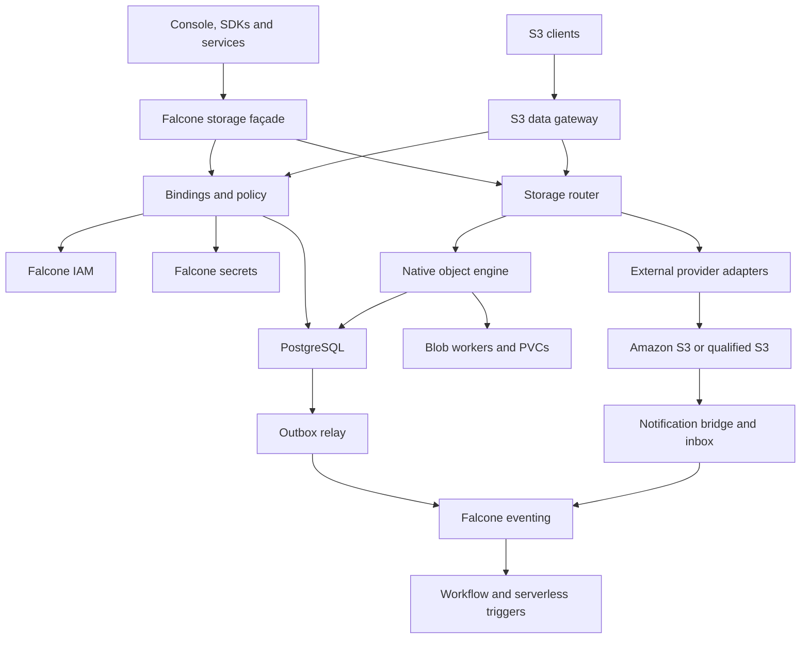
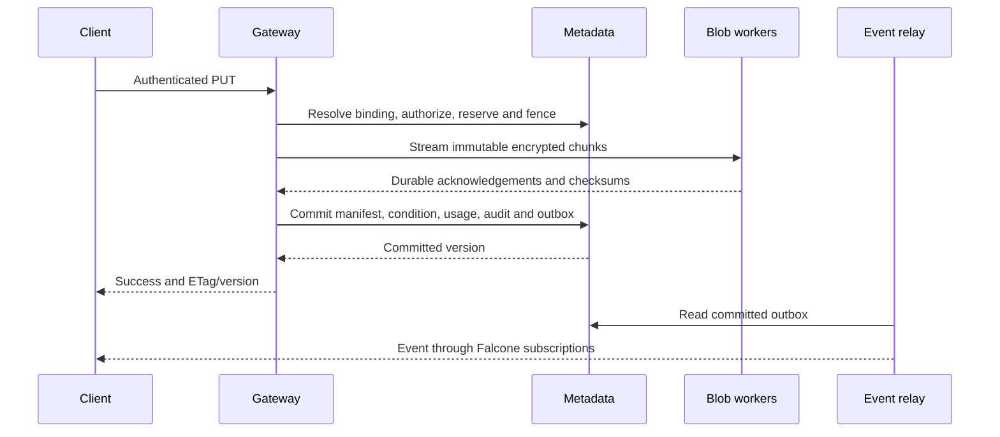

# Baseline architecture

Status: proposed detailed design. Native storage and external S3 choice are confirmed product scope. All capability claims below are targets until qualified. See [ADR 0001](decisions/0001-native-and-external.md).

## Modules and dependencies

IAM and secrets are enforcement/custody dependencies, not in the streaming byte path per chunk. Bounded authorization and key caches must respect revocation and key-lifecycle rules. Native bytes never pass through PostgreSQL. External bytes may pass through the gateway or an explicitly enabled direct presigned path; direct access does not traverse Falcone admission on every request.

| Component | Proposed stack | Responsibility and rationale |
|---|---|---|
| Product façade and management API | TypeScript/Node.js, existing Falcone schema conventions | Preserve current interfaces and governance contracts; reuse existing code ownership |
| S3 gateway and native byte workers | Go, maintained HTTP/TLS/crypto libraries | Bounded streaming, request cancellation and native worker concurrency; benchmark before language commitment |
| Internal API | Versioned protobuf/gRPC over authenticated TLS, or shared HTTP contracts where already standardized | Explicit authorization context, deadlines and typed data handles; no guest-supplied tenant trust |
| Metadata/control state | PostgreSQL with explicit schema migrations and transactional outbox | Atomic native metadata, quota reservation and event intent; separate database/role from SeaweedFS filer |
| External adapters | Maintained AWS SDKs and provider-specific qualified profiles | SigV4 request construction, retry controls and credential refresh without inventing another cloud API |
| Native media | Ordinary StatefulSets, PVCs from approved CSI classes | No host disks, FUSE, privileged daemon or storage operator prerequisite; actual media failure domains must be known |
| Background work | Leased workers, PostgreSQL fencing and bounded queues | Repair, lifecycle, GC, reconciliation and migration; no replacement workflow runtime inside storage |
| Events | Existing Falcone Kafka-compatible event boundary; native outbox/external inbox | Reuse product routing, schemas and durable processing; broker loss must not lose committed event intent |
| Auth/key custody | falcone-iam and falcone-secrets; transitional Keycloak/OpenBao adapters where necessary | Keep platform ownership and accepted secrets decisions |
| Deployment/telemetry | Helm or manifests without CRDs; OpenTelemetry, Prometheus-compatible metrics | Fit restricted OpenShift; expose dependency and durability state |

Do not create a mandatory new cache, operator, service mesh, broker, custom scheduler or consensus cluster. Existing ingress/APISIX, PostgreSQL, eventing, DNS/TLS and storage provisioning are retained dependencies. Native storage eventually replaces SeaweedFS master/volume/filer/S3 components only for migrated bindings. External mode needs no native blob cluster.

## Authoritative state

| Entity | Owner and key fields |
|---|---|
| Provider profile | Operator-scoped ID, adapter/release, endpoint trust policy, capability revision, credential method, health and residency |
| Storage binding | Logical bucket ID, tenant/workspace, provider ID, backend bucket, optional constrained prefix, managed/adopted ownership, access mode, writer epoch, migration state |
| Native object/version | Binding + opaque key + immutable version ID; current pointer/delete marker, size, content type, metadata/tags, checksum, ETag, retention, encryption reference and chunk manifest |
| Native chunks | Immutable chunk ID, encrypted payload/checksum, placement generation and acknowledged durable locations |
| Multipart session | Scoped upload ID, part manifest/checksums, expiry, reservations, completion state and pinned writer epoch |
| Governance state | Falcone quota policy revision, reservations and usage facts; Falcone owns limits |
| Events/jobs | Outbox or external inbox ID, scope, key/version, source cursor, retry state, lease/fence and audit correlation |
| External objects | **External provider is authoritative**; Falcone stores routing, operation journal, reference pins and optional freshness-labeled indexes |

Use logical IDs, not display names, as authorization keys. Buckets retain the current workspace registry model. Keys are object names, not host paths. Native filesystem paths derive from internal IDs. Existing Falcone key-organization validation remains a façade contract; the raw S3 layer must not apply POSIX normalization to signed keys.

## Native PUT and GET

1. Verify Falcone session/workload identity or S3 SigV4. Resolve trusted access-key and bucket ownership; authorize resource/action and prefix. Check capability, request limits, writer epoch and applicable quota mode.
2. Stage chunks with bounded memory, backpressure, checksums and independently wrapped per-object/version keys. Enforce physical capacity and temporary-upload limits.
3. Once required durable replicas acknowledge, perform the final conditional check and transactional manifest/current-pointer update. Commit native usage delta, audit acceptance and outbox intent with it. A failed condition leaves reclaimable staged data, never a partial object.
4. Return success only after committed metadata and required byte durability. A response lost after commit is an ambiguous client outcome; retries follow protocol-specific conditional/idempotency rules.
5. GET authorizes again, reads a committed manifest, validates/decrypts requested chunks and streams a range or complete body. JSON façade responses retain their contract and configured size ceiling. Logs contain operation IDs and redacted context, not bytes or credentials.

## External PUT and GET

The router selects the binding's adapter and resolves scoped credentials from secrets or a qualified workload-identity exchange. It signs the backend request, translates only approved fields and streams with limits. Backend conditional behavior must be real; a HEAD-then-PUT fallback is not atomic. The result is recorded in Falcone's operation journal and usage reconciliation state.

Remote object mutation and local database commit cannot be one transaction. If the provider committed but the response/journal failed, mark the operation outcome uncertain and reconcile by supported provider evidence. Do not blindly repeat non-idempotent versioned writes or hide uncertainty. External GET/HEAD/LIST consult the provider, not a stale native metadata table. Optional indexes expose their last reconciliation time.

An opted-in direct presigned URL points to the provider, expires no later than credential lifetime, and bypasses Falcone's per-request enforcement. Subsequent events or scans reconcile usage and trigger state. A strict Falcone quota/revocation profile must reject access modes that cannot meet its guarantees.

## Control and failure boundaries

Each binding has one writer epoch. Migration and background jobs must prove current authority before publishing changes. Native metadata transactions enforce the epoch; external writers also need enforceable provider-side fencing or a quiescent cutover window. A database epoch alone cannot revoke an already issued external URL or a customer's independent credentials.

External provider outage affects its bindings; do not silently redirect to an empty native store. PostgreSQL loss prevents authoritative native namespace operations. Secret/IAM outage follows bounded valid-cache rules then denies protected operations; it never broadens access. A broker outage accumulates durable event intent until configured backlog limits require throttling. Direct external requests have provider-specific availability and audit coverage distinct from gateway requests.
